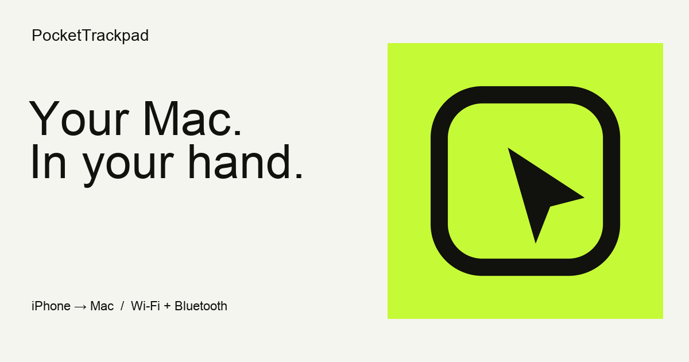

<p align="left"></p>

# PocketTrackpad

### Your Mac. In your hand.

An iPhone controller and a native Mac receiver. Move, click, scroll, zoom, and switch desktops over Wi-Fi or Bluetooth. A nearly empty touch surface with four customizable keys—Esc, Tab, Backspace, Enter by default—and a microphone. Built for short instructions and hands-on control of desktop tools such as Codex and Claude Code.

[Website](https://pocket-trackpad.doohyun726675.chatgpt.site/) · [Download for Mac](https://pocket-trackpad.doohyun726675.chatgpt.site/downloads/PocketTrackpad-Mac-1.4.26.dmg) · [Setup & support](https://pocket-trackpad.doohyun726675.chatgpt.site/support.html) · [Privacy](https://pocket-trackpad.doohyun726675.chatgpt.site/privacy.html)




## Get started

1. Install the iPhone controller and the separate Mac receiver. Use the existing [iPhone App Store listing](https://apps.apple.com/app/id6829109280); the latest uploaded iPhone build is 1.4.27 (70); the current Mac receiver is 1.4.26.
2. Open the Mac receiver. Allow it in **System Settings → Privacy & Security → Accessibility**.
3. Scan the Mac QR code from the iPhone app. Choose **Wi-Fi** on the same local network, or **Bluetooth** nearby.
4. Keep the iPhone app open and start moving. Open the Mac DMG and drag PocketTrackpad to Applications. The Mac window stays open after connection. Close the window to keep the receiver running in the background, or use Quit / Command-Q to disconnect and fully exit. Reopening the app shows its connection status and QR again. The iPhone Settings sheet stays open until you dismiss it.

When updating the Mac app, click **Quit** in the existing receiver before replacing it. Closing its window keeps it running. Run one receiver at a time.

The Mac download is signed with Developer ID and notarized by Apple. The source build uses local ad hoc signing unless you supply your own signing identity.

The first connection screen explains that both apps are required and links directly to the Mac download and setup guide.

The Mac window shows the current connection round-trip time in milliseconds. This is the iPhone-to-Mac-to-iPhone transport round trip, not total finger-to-display latency. Both apps must be updated for the measurement; stale readings are cleared.

## Four keys and a microphone

The bottom row defaults to **Esc, Tab, Backspace, and Enter**. In Settings → Quick keys, assign each position independently: plain keys, arrows, Shift+Tab, Ctrl+C, Copy, Paste, Undo, Redo, or Select all. Assignments survive app restarts. Shortcuts act on the focused Mac app; their meaning follows that app.

Tap for one immediate input, or hold to repeat. Settings → Quick keys lets you adjust the hold delay (0.20–1.00 seconds, default 0.35) and Key repeat speed (5–60 repetitions per second, default 30). Settings are saved on the iPhone and sent to the Mac over either connection. Update both apps to 1.4.26 or later to customize the shared repetition rate.

Version 1.4.6 forwards the iPhone microphone to a virtual Mac input device. In the Mac window, choose **Settings…**, click **Connect** beside each receiving desktop app. Both connections stay saved. PocketTrackpad reads the app’s existing dictation preference or opens its settings to read the shortcut. If no shortcut is assigned, setup opens the app’s shortcut control so you can assign one there and read it again. It never edits the other app’s preference files or silently creates shortcuts.

Codex global dictation prefers the assigned `globalDictationToggleHotkey` preference (with a fallback to `globalDictationHotkey`) from its local `.codex-global-state.json` file, read only. It does not reuse an injected command override from `keybindings.json`. Supported apps with accessible dictation controls are read through macOS Accessibility. Connected applications are monitored for shortcut changes. The receiver updates its own mapping when a dictation setting changes, and rechecks the app after a restart or whenever the saved mapping cannot be validated. Unsupported or inaccessible settings produce a setup prompt rather than a guessed shortcut. Manual connection remains available for unsupported versions. Automatic setup requires macOS 14.2 or later; desktop-app UI changes can affect compatibility.

Click the receiving app’s input window, then tap the phone microphone to request recording; tap again to request stop. The trackpad remains available. Use iPhone and Mac 1.4.6 or later for this setup flow. The phone shows microphone state through its icon, without a text overlay.

In the Mac window, choose **Settings… → iPhone microphone → Install…** once. The signed Core Audio driver requires administrator authentication and briefly restarts Mac audio. It leaves other audio drivers in place. Audio follows the selected connection without switching transports in the background. Wi-Fi uses its own authenticated TLS audio socket. Bluetooth uses a separate encrypted microphone characteristic, with speech-band audio compression and a bounded queue so audio cannot grow indefinitely behind trackpad input. Both apps must be 1.4.6 or later for Bluetooth audio. No audio file or transcript is created by PocketTrackpad; GPT performs recognition under its own settings and privacy policy. There is no PocketTrackpad recording-duration limit.

Stop cancels the audio sender before sending the stop command; it does not wait for audio acknowledgements. Stop remains available until the Mac confirms it. Each recording has its own session ID, so late audio, replies, and cancellation from a previous recording cannot act on a new session. For a toggle shortcut, stopping returns to the original receiving app if focus has moved.

Disconnecting or leaving the phone app stops capture. The Mac attempts to stop the same GPT recording and restores the previous microphone only after that stop is confirmed. If confirmation fails during a session, it leaves a silent virtual input selected to avoid switching an active recording to a room microphone. Quitting the Mac receiver explicitly restores the prior system input, with a built-in microphone fallback; the installed virtual device remains listed in Sound settings. PocketTrackpad does not submit the resulting message.

Hold a keyboard key to repeat it at your selected rate. Backspace, Enter, Tab, Space, arrows, and editing shortcuts use the same setting. Mission Control remains a single action; scroll keys use continuous scrolling.

Use iPhone and Mac **1.3.0 or later** for the expanded customizable key set. Older receivers continue to support their original commands; unsupported keys prompt for a Mac update. Trackpad movement and existing gestures retain their existing transport path.

Settings → On-screen controls lets you hide the quick-key row, microphone button, and top controls independently. A 44-point reveal handle remains available; recording always keeps a stop button visible. Transient notices dismiss automatically, while the last microphone error remains in settings. Fold or expand the controls yourself with the arrow. They do not auto-hide, and the chosen state persists across restarts. The user verified this behavior in 1.4.3.

## A familiar set of gestures

| Touch | Action |
| :--- | :--- |
| One finger | Move the pointer; tap to click; double-tap to double-click |
| Double-tap, hold the second tap | Drag immediately; lift to release |
| Two fingers | Momentum scrolling; page history and pinch zoom in supporting apps |
| Two-finger tap | Right-click |
| Two fingers inward from the right edge | Reveal Notification Center; swipe outward after opening to close |
| Four-finger pinch / spread | Show installed apps / reveal the desktop, with continuous progress |
| Three-finger swipe | Mission Control, App Exposé, or desktop switching |

Adjust cursor speed, natural scrolling, double-tap timing, press delay, and haptic behavior. Rotate the surface with the rotation button. The lock button defers system edge gestures; hold it to unlock. It cannot completely disable iOS Home or Control Center gestures.

Pinch, page navigation, and system gestures depend on the receiving app and macOS settings. This is a software controller, not a replacement for every Apple trackpad hardware feature. On iPhones without pressure sensing, press-to-click uses hold duration rather than measured force. Haptics and timing are configurable.

[View the controller settings](docs/assets/settings.png).

## Two apps, one local connection

| Component | Requirement | Role |
| :--- | :--- | :--- |
| iPhone controller | iOS 17 or later | Multitouch input, gestures, haptics, connection settings |
| Mac receiver | macOS 13 or later; Apple silicon or Intel | Authenticated transport, pointer and gesture delivery |

Input travels directly between your devices. There is no developer-operated input relay, account system, advertising SDK, or analytics SDK. Treat the pairing QR as a control key and keep it private.

Wi-Fi uses Network.framework with TLS and a QR-derived pre-shared key. Bluetooth uses CoreBluetooth, system link encryption, and a QR-key challenge. The phone is the Bluetooth peripheral; the Mac discovers and connects to it. See [Architecture](docs/architecture.md) for the input pipeline and implementation limits.

## Build from source

You need a Mac with Xcode, its command-line tools, and the required Apple SDKs. The apps do not require Python, Node, or third-party packages at runtime.

### Mac

```sh
./build.command
open build/mac/PocketTrackpad.app
```

The build produces a universal `arm64` / `x86_64` app. Local builds do not overwrite the retained notarized release. To sign your own distribution build:

```sh
POCKET_MAC_SIGN_IDENTITY="Developer ID Application: Your Name (YOURTEAMID)" \
  ./build.command
```

Notarization is a separate Apple distribution step. A locally rebuilt app may need its own Accessibility permission; the downloaded release and a local build are different signatures.

### iPhone

Open `native-ios/PocketTrackpad.xcodeproj` in Xcode. Select your development team and a unique bundle identifier in **Signing & Capabilities**, then run on your device. The public project does not include the maintainer’s signing profile or private keys. Simulator builds do not need signing:

```sh
xcodebuild -project native-ios/PocketTrackpad.xcodeproj \
  -scheme PocketTrackpad -configuration Debug \
  -sdk iphonesimulator -destination 'generic/platform=iOS Simulator' \
  -derivedDataPath build/ios CODE_SIGNING_ALLOWED=NO build
```

### Checks

```sh
./scripts/check-core.command
./native-ios/check.command
```

The first command exercises gesture recognition, wire validation, motion playback, scroll delivery, and serialization without controlling the desktop. The iPhone check also builds the unsigned device target. These checks do not establish end-to-end radio latency or physical iPhone gesture feel. Manual desktop probes live under `Tests/PageNavigation`, `Tests/PageSwipe`, and `Tests/CursorDelivery`; they are intentionally excluded from the automatic checks.

## Repository map

```text
native-ios/       iPhone app, Xcode project, gesture tests
shared/           Framing, secure connection setup, Bluetooth wire format
Host.swift        Native Mac receiver and input application
MacQuickKeys.swift
MacSystemActions.swift
ConnectionState.swift
CursorBounds.swift
MotionPlayback.swift
NativeScroll.swift
NativeMagnify.m
NativeDockSwipe.c
Tests/            Focused Mac and transport checks
mac-resources/    Mac metadata and English/Korean localization
vendor/           Gesture serialization dependencies and notices
website/          Static product, support, and privacy pages
scripts/          Source-only validation
```

The website directory contains the public page source. Published binary downloads are release artifacts, not source files in Git. Historical prototypes, timing recordings, QR captures, certificates, upload credentials, caches, and distribution archives are excluded.

## Implementation notes

macOS continuous desktop gestures and some pinch/page transitions use undocumented gesture serialization. These adapters can be affected by macOS changes. They are isolated in the native gesture modules; the Mac receiver is distributed directly, not through the Mac App Store. No claim is made that these interfaces are supported by Apple.

The identity combines a touch surface and a pointer in a single mark. Black type, open space, and an acid-green field carry the same visual language across the icon, website, and documentation. Brand files are in [docs/assets](docs/assets).

## Support and contribution

Report reproducible bugs through GitHub Issues. Include your iOS/macOS versions, connection type, expected behavior, and observed behavior. Do not post pairing QR codes, private device logs, Apple credentials, or signing files. For security-sensitive reports, email [dhleekr7@gmail.com](mailto:dhleekr7@gmail.com). See [CONTRIBUTING.md](CONTRIBUTING.md).

## Copyright and third-party notices

Copyright © 2026 Doohyun Lee. All rights reserved for original source and brand assets; this public repository does not grant an additional license to them. Third-party code retains its own license. See [THIRD_PARTY_NOTICES.md](THIRD_PARTY_NOTICES.md).

### Virtual microphone

The Mac build bundles a signed Core Audio driver derived from Apple's MIT-licensed NullAudio sample. See [third-party notices](THIRD_PARTY_NOTICES.md) and [driver provenance](virtual-microphone/vendor/SOURCE.txt). The iPhone build has no bundled speech model or speech-recognition dependency. The released 1.3 version used on-device recognition; 1.4 replaces that path with audio forwarding.

The Mac receiver keeps a single Settings button in its window. Settings groups Mac control permission, microphone installation, and dictation connection. Microphone installation opens a separately signed macOS Installer package, with no Terminal window. Only Installer requests administrator authorization; the receiver does not elevate itself. The Sound input list exposes one iPhone microphone source. Quit is available in the app menu or with Command-Q; closing the window preserves the connection.

Mac 1.4.7 adds the standard Command-W Close Window action. Closing the window keeps the receiver running; Command-Q quits. The iPhone build remains 1.4.6 (47).

Mac 1.4.9 improves vertical scrolling with a source-time speed curve and a smaller initial pixel dead zone. Delayed input batches use bounded catch-up instead of collapsing into a large first-frame jump. Radio latency and display refresh remain hardware-dependent.

Mac 1.4.12 keeps active microphone sessions running across app focus changes, uses Codex’s assigned single-tap dictation shortcut, and prefers Claude’s Dictate and Finish controls. Start, background recording, and stop were verified locally in both target apps. App versions and accessibility exposure can affect compatibility. The iPhone 1.4.12 release packages the existing controller with the current companion setup; these microphone fixes are in the Mac receiver.

## Bluetooth pairing isolation (1.4.24)

Install 1.4.24 or later on both the iPhone and Mac for Bluetooth. Discovery uses an opaque service identifier derived from the existing Mac QR pairing key. The Mac checks this identifier before connecting, so another user's nearby PocketTrackpad phone does not trigger an encryption or pairing attempt. The phone advertises only that QR-specific service; there is no fallback to the shared legacy service. Mutual QR authentication and Bluetooth link encryption remain required after discovery.

The saved QR pairing key is unchanged. Wi-Fi remains compatible with existing versions. Bluetooth requires the matching update on both devices.

## Previous release: 1.4.23

- One immediate key press per short tap, with a configurable hold delay and Backspace repeat speed.
- Held keys keep a continuous down/repeat/up sequence and release on lift or connection loss.
- Two-finger scrolling and pinch-to-zoom use clearer intent thresholds and stay in the selected gesture until lift.
- Pinch the QR camera preview to zoom; a small zoom value appears only while adjusting it.
- Includes the previous improvements to microphone continuity, scrolling, and window handling.

The release was checked with the focused repeat/wire tests and full core checks. The user verified the final iPhone and Mac behavior before publication. Desktop-app and macOS compatibility limits described above still apply.

## Previous release: 1.4.24

- QR-scoped Bluetooth discovery filters out unrelated nearby devices before initiating a connection or encrypted GATT subscription.
- Both the iPhone controller and Mac companion must be 1.4.24 or later for Bluetooth. Existing QR pairing keys are retained; no legacy shared-service fallback is used.
- Direction-bound authentication, Bluetooth encryption, and Wi-Fi behavior are preserved.
- The actual Mac discovery callback passes the unrelated-device regression test. All core checks pass; the iPhone archive and signed Mac build succeeded.

## Previous release: 1.4.25

- Assign Mission Control, Scroll up, or Scroll down to any of the four quick keys.
- Scroll buttons send one initial movement and continuous, time-based scrolling while held, ending immediately on release or input cancellation. Mission Control is a single tap action.
- A dedicated native action list groups Mac actions, keyboard keys, and editing commands. Live connection updates do not rebuild the scrolling table.
- Includes QR-scoped Bluetooth discovery from 1.4.24.

## Previous release: 1.4.26

Quick keys now share one **Key repeat speed** setting (5–60 repetitions per second). It applies to held keyboard actions including Backspace, Enter, Tab, arrow keys, and editing shortcuts. The initial press remains immediate, and the repeat delay still controls when repetition starts. Existing Backspace speed preferences migrate to the new shared setting without changing the saved value. Mission Control remains a single-tap action; scroll buttons retain continuous scrolling. Update both apps to use the shared speed. Older receivers advertise no support, so the iPhone disables the shared speed control and displays update guidance.

## Current iPhone release: 1.4.27 (70)

Settings → Quick keys now includes **Scroll key speed**, from 0.25× to 4× (default 1×). It adjusts continuous scrolling while holding Scroll up or Scroll down, independently of keyboard repeat speed. Two-finger trackpad scrolling and the initial scroll tap are unchanged. The setting is saved on the iPhone and works over Wi-Fi and Bluetooth with the existing Mac 1.4.26 receiver; no Mac update is required.

Validation: rate and cadence regression tests, release-on-lift checks, iOS build, and simulator layout checks passed. The user verified the TestFlight build before App Store submission.
