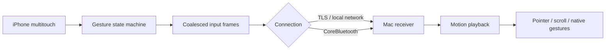

# Architecture

## Input path

The iPhone recognizes gesture boundaries before transport. Relative motion may be coalesced while click, release, cancellation, and gesture phase boundaries are preserved. The Mac schedules continuous motion against a playback timeline rather than treating packet arrivals as display frames. Small displacements retain fractional precision. Vertical scrolling applies a source-time speed curve before display interpolation; horizontal page tracking is unchanged. The pixel adapter retains rounding error and responds at half a point. Scroll playback does not shift queued history into the past when its clock estimate improves. Delayed startup batches use bounded catch-up with at most 40 ms of extra queued time, without predicting movement. Pointer and system-gesture timelines retain their previous timing policy. Timing and physical radio performance still depend on hardware and network conditions.

The pointer uses Quartz desktop coordinates across active displays, including negative origins. `CursorBounds` refreshes the display layout within 250 ms of subsequent motion, so connecting, moving, resizing, or removing a display does not leave the background receiver constrained to its startup layout. Geometry is cached between refreshes to avoid a display query on every motion frame.

## Short commands and dictation

`PadQuickKey` is the shared four-key contract for the phone labels, validated wire commands, and native Mac key codes. `MacQuickKeys` emits a complete modifier/key sequence; its regression checks inspect events without posting them and ensure Shift is released after Shift+Tab. Notification Center uses the system clock's Accessibility action; installed apps use the macOS Apps utility, with Launchpad as the older-system fallback. These open on gesture completion and can be cancelled before finger lift.

The receiver advertises protocol 2 in authenticated responses. New controller features are gated on that capability, preserving the connection to older receivers. Text is a bounded, authenticated event with a receipt identifier. The phone clears its draft only after a Mac acknowledgment and does not retry automatically after an uncertain disconnect. The Mac sends Unicode in bounded chunks without splitting surrogate pairs or touching the clipboard. Some Mac applications can interpret synthetic text differently; physical-app verification remains necessary.

Microphone capture begins only after an explicit phone action and system authorization. Raw PCM travels through a separate authenticated Wi-Fi socket to the paired Mac virtual input, using bounded memory without audio files or transcripts. The receiving GPT app performs recognition under its own privacy settings. The Mac registers or reuses a local hold-to-dictate shortcut; CoreAudio input metadata confirms recording begins. Stop, disconnect, and receiver shutdown release the key and silence the route. The previous physical microphone is restored only after stop is confirmed. See [microphone integration](gpt-microphone-integration.md).

## Transport and pairing

The Mac generates and retains a pairing key locally. Its QR carries the address and pairing material. Wi-Fi uses TLS pre-shared-key configuration through Network.framework. Bluetooth is a reverse connection: the phone advertises as a peripheral and the Mac scans as a central. CoreBluetooth link encryption and the application QR-key challenge protect Bluetooth pairing. Do not publish real pairing codes or diagnostic captures.

The protocol validates frame lengths, identifiers, event kinds, finite numeric values, and gesture phases. Disconnects release active input. The current receiver does not depend on the historical browser/Python prototype.

## Connection presentation

The receiver keeps Wi-Fi and Bluetooth status separately. An idle or failed transport must not overwrite the other transport’s authenticated connection. The same connection reducer is covered by regression tests.

The iPhone measures acknowledgments with a monotonic clock and includes an optional RTT sample in an existing input frame at most once per second. The Mac validates the metadata and shows only the active transport's fresh sample. Samples older than three seconds are hidden. This does not measure end-to-end input-to-display latency. Older peers remain protocol-compatible without showing a measurement.

The Mac window never auto-hides on connection. Its close delegate hides only the window. Quit and Command-Q terminate the receiver and release active input. A second receiver instance asks the earlier process to reveal its window, then exits before constructing another input engine or binding a listener.

## Native delivery

The receiver needs macOS Accessibility authorization. Pointer and scroll events use native event delivery. `NativeMagnify.m`, `NativeScroll.swift`, and `NativeDockSwipe.c` isolate gesture adapters, including undocumented serialized events. Their behavior is OS-dependent. Changes here require meaningful regression checks and manual validation in real receiving apps.

## Build and distribution

The public Xcode project has no development team configured. Each developer supplies their own team, bundle identifier, and distribution setup. Mac local builds go to `build/mac`; signed and notarized distribution artifacts remain separate. Neither signing material nor App Store archives belong in this repository.

Website source lives in `website/`. The live site is hosted separately and serves the signed Mac ZIP. Do not infer public App Store availability merely from a successful TestFlight upload.
