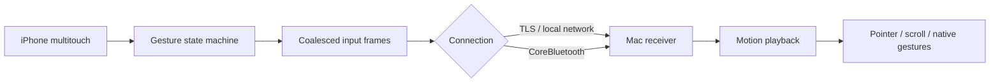

# Architecture

## Input path

The iPhone recognizes gesture boundaries before transport. Relative motion may be coalesced while click, release, cancellation, and gesture phase boundaries are preserved. The Mac schedules continuous motion against a playback timeline rather than treating packet arrivals as display frames. Small displacements retain fractional precision. Timing and physical radio performance still depend on hardware and network conditions.

## Transport and pairing

The Mac generates and retains a pairing key locally. Its QR carries the address and pairing material. Wi-Fi uses TLS pre-shared-key configuration through Network.framework. Bluetooth is a reverse connection: the phone advertises as a peripheral and the Mac scans as a central. CoreBluetooth link encryption and the application QR-key challenge protect Bluetooth pairing. Do not publish real pairing codes or diagnostic captures.

The protocol validates frame lengths, identifiers, event kinds, finite numeric values, and gesture phases. Disconnects release active input. The current receiver does not depend on the historical browser/Python prototype.

## Connection presentation

The receiver keeps Wi-Fi and Bluetooth status separately. An idle or failed transport must not overwrite the other transport’s authenticated connection. The same connection reducer is covered by regression tests.

## Native delivery

The receiver needs macOS Accessibility authorization. Pointer and scroll events use native event delivery. `NativeMagnify.m`, `NativeScroll.swift`, and `NativeDockSwipe.c` isolate gesture adapters, including undocumented serialized events. Their behavior is OS-dependent. Changes here require meaningful regression checks and manual validation in real receiving apps.

## Build and distribution

The public Xcode project has no development team configured. Each developer supplies their own team, bundle identifier, and distribution setup. Mac local builds go to `build/mac`; signed and notarized distribution artifacts remain separate. Neither signing material nor App Store archives belong in this repository.

Website source lives in `website/`. The live site is hosted separately and serves the signed Mac ZIP. Do not infer public App Store availability merely from a successful TestFlight upload.
